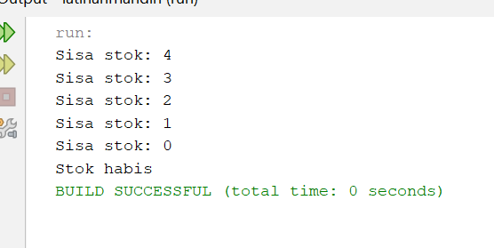
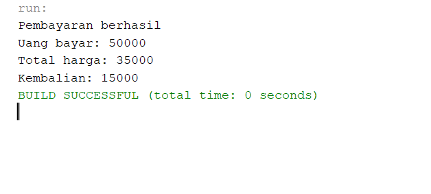
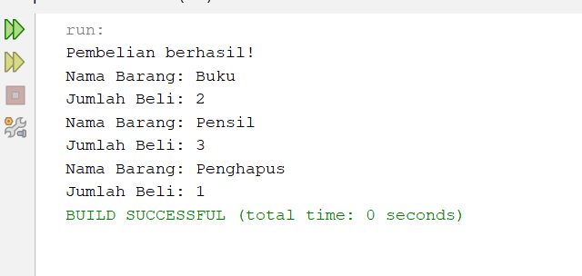

# kumpulanlatihan
nama: Deva Sayyidatul Adawiyah
NIM : C2483207001
tugas dasar pemograman java
# LATIHAN DASAR PEMROGRAMAN JAVA

Repository ini berisi kumpulan hasil latihan praktikum mata kuliah Dasar Pemrograman Java. Latihan berfokus pada penggunaan perulangan (looping) dan method dalam bahasa pemrograman Java.

## Latihan 1 – Nomor Urut Barang

**Tujuan:**

Menggunakan perulangan `for` untuk menampilkan nomor urut barang dari 1 sampai 10, kemudian mengubah perulangan agar menampilkan nomor dari 10 sampai 1.

**Materi:**
- Perulangan `for`
- Increment (`i++`)
- Decrement (`i--`)

**Hasil Program:**

## Latihan 2 – Simulasi Stok

**Tujuan:**

Membuat simulasi stok barang dengan nilai awal 5. Menggunakan perulangan `while` untuk mengurangi stok satu per satu hingga habis dan menampilkan sisa stok pada setiap pengulangan.

**Materi:**
- Perulangan `while`
- Variabel
- Decrement (`stok--`)

**Hasil Program:**

## Latihan 3 – Method Kembalian

**Tujuan:**

Membuat method `hitungKembalian(int uangBayar, int totalHarga)` untuk menghitung jumlah kembalian dari hasil pengurangan uang bayar dengan total harga. Method digunakan pada proses pembayaran berhasil.

**Materi:**
- Method
- Parameter
- Return value
- Tipe data `int`

**Hasil Program:**

## Latihan 4 – Method Daftar Barang

**Tujuan:**

Memindahkan perulangan penampil barang ke dalam method `tampilkanDaftarBarang(String namaBarang, int jumlahBeli)` dengan tipe kembalian `void`. Method dipanggil setelah pembelian dinyatakan berhasil.

**Materi:**
- Method `void`
- Parameter `String` dan `int`
- Perulangan `for`
- Pemanggilan method

**Hasil Program:**

---

### Informasi Praktikum

- **Bahasa Pemrograman:** Java
- **IDE:** NetBeans
- **Mata Kuliah:** Dasar Pemrograman
- **Materi:** Perulangan dan Method
